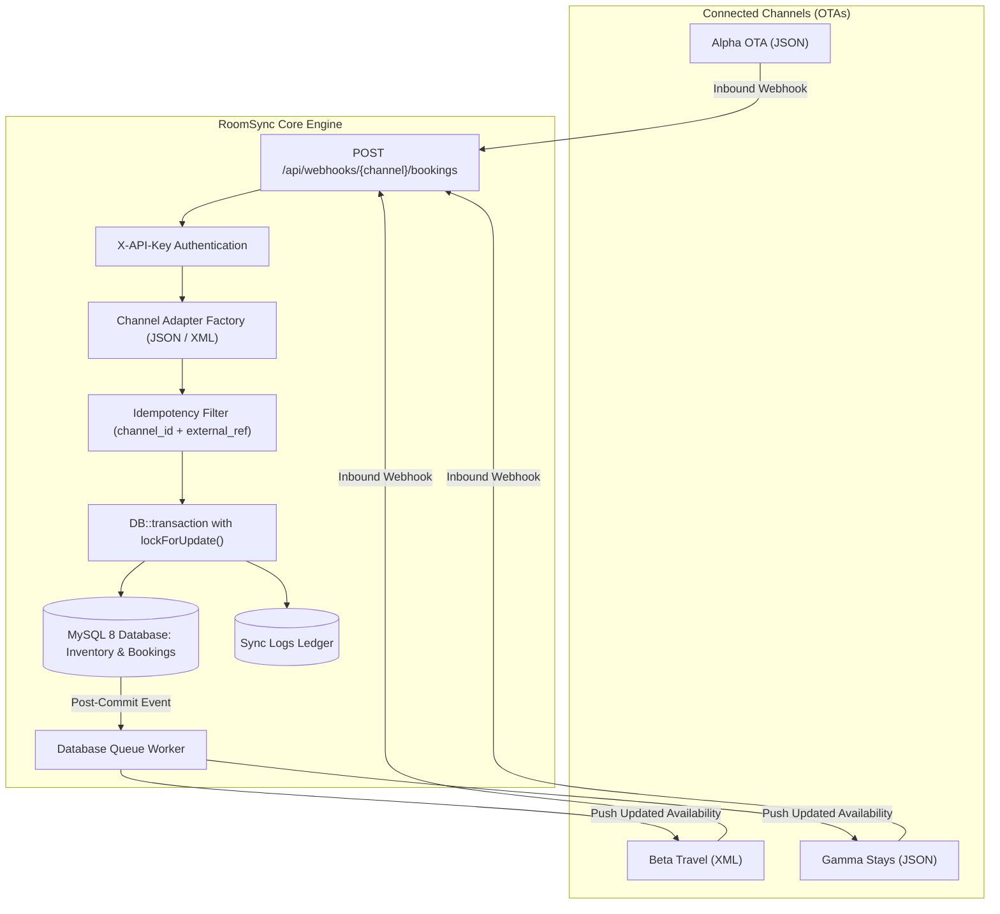

# RoomSync

> A lightweight, multi-channel hotel inventory and rate manager (site controller) built with **PHP 8.3**, **Laravel 11**, and **MySQL 8**. Keeps room counts in sync across multiple Online Travel Agencies (OTAs) with zero double bookings.

---

### 🌐 Live Deployment
- **Live URL:** [http://16.192.250.54/](http://16.192.250.54/)
- **Infrastructure:** Deployed on an **AWS EC2** instance backed by an **AWS Elastic IP** — ensuring this URL remains permanent and consistent across instance stops and starts.
- **Architecture & CI/CD:** Fully containerized with multi-stage **Docker & Docker Compose**, featuring an automated **GitHub Actions** CI/CD pipeline that tests, builds, and rolls out zero-downtime updates on every push.

> *Note: To conserve cloud compute credits, the EC2 instance may be powered down when not actively undergoing review, but the assigned Elastic IP and configuration above remain fixed.*

---

## 🏗️ Architecture Overview



---

## ⚡ The Overbooking Problem & Atomic Concurrency

### The Problem
When a hotel lists 1 remaining room across Booking.com, Expedia, and Airbnb simultaneously, two guests can click "Book Now" at the exact same millisecond. 

In a naive implementation:
1. **Thread A** checks availability: sees 1 room available.
2. **Thread B** checks availability: also sees 1 room available.
3. **Thread A** decrements inventory to 0 and confirms.
4. **Thread B** decrements inventory to -1 and confirms.
5. **Result:** Two guests show up for the same room (**Overbooking disaster**).

### The Solution: Row-Level Locking (`lockForUpdate`)
RoomSync uses pessimistic row-level locking (`SELECT ... FOR UPDATE`) ordered strictly by date inside an atomic database transaction:

```php
DB::transaction(function () use ($channel, $data, $datesNeeded, $roomsRequested, &$booking) {
    // 1. Lock all nights ordered by date to prevent deadlocks
    $inventoryRows = Inventory::where('room_type_id', $data['room_type_id'])
        ->whereIn('date', $datesNeeded->all())
        ->orderBy('date', 'asc')
        ->lockForUpdate()
        ->get();

    $rowsByDate = $inventoryRows->keyBy(fn ($r) => Carbon::parse($r->date)->toDateString());

    // 2. Atomic all-or-nothing check across the full multi-night stay
    foreach ($datesNeeded as $dateStr) {
        $row = $rowsByDate->get($dateStr);
        if (!$row || $row->available < $roomsRequested) {
            $booking = Booking::create([..., 'status' => 'rejected', 'reason' => 'Insufficient inventory']);
            return; // Transaction commits rejected booking without touching inventory
        }
    }

    // 3. Decrement all nights atomically
    foreach ($datesNeeded as $dateStr) {
        $rowsByDate->get($dateStr)->decrement('available', $roomsRequested);
    }

    $booking = Booking::create([..., 'status' => 'confirmed']);
});
```

Because **Thread A** holds the exclusive row lock, **Thread B** is queued until Thread A commits. Once Thread B acquires the lock, it immediately reads `available = 0`, rejects the request with HTTP `409 Conflict`, and saves an audit record without overbooking.

---

## 🔌 Channel Adapter Pattern

Different OTAs use completely different API communication formats. RoomSync resolves this via the **Adapter Pattern**:

```
                  ┌────────────────────────┐
                  │ ChannelAdapterInterface│
                  └───────────┬────────────┘
                              │
             ┌────────────────┴────────────────┐
             ▼                                 ▼
   ┌───────────────────┐             ┌───────────────────┐
   │    JsonAdapter    │             │    XmlAdapter     │
   │ application/json  │             │  application/xml  │
   └───────────────────┘             └───────────────────┘
```

- **`JsonAdapter`**: Serializes outbound arrays with `json_encode` and parses inbound requests via `json_decode`.
- **`XmlAdapter`**: Generates outbound XML using `SimpleXMLElement` and parses inbound XML via `simplexml_load_string`.
- **`ChannelAdapterFactory`**: Resolves the adapter dynamically using PHP 8.3 `match($channel->format)`.

---

## 🗄️ Database Architecture

RoomSync includes 7 core tables:

| Table | Purpose |
|---|---|
| `hotels` | Master hotel properties (`id`, `name`). |
| `room_types` | Room categories (`total_rooms`, `base_rate`). |
| `inventory` | Source-of-truth inventory by day (`room_type_id`, `date`, `available`, `rate`). Unique on `(room_type_id, date)`. |
| `channels` | Connected OTAs (`name`, `format` [json/xml], `endpoint_url`, `api_key`, `active`). |
| `bookings` | Recorded reservations (`room_type_id`, `channel_id`, `external_ref`, `check_in`, `check_out`, `rooms`, `status`). Unique on `(channel_id, external_ref)` for DB-level idempotency. |
| `sync_logs` | Append-only audit ledger (`channel_id`, `direction` [in/out], `event`, `payload`, `response_code`, `status`, `attempts`). |
| `mock_ota_inventory` | Local mirror of what each mock OTA believes its inventory is. |

---

## 🚀 Quick Start Guide

### Prerequisites
- Docker & Docker Compose
- Make (optional, but recommended)

### 1. Start the Environment
```bash
# Clone the repository
git clone https://github.com/itsXILO/RoomSync.git
cd RoomSync

# Start Docker containers via Sail
make up
```

### 2. Seed Database
```bash
# Run migrations and seed demo hotel, room types, 60 days of inventory, and 3 channels
make seed
```

### 3. Open in Browser
Visit **[http://localhost](http://localhost)** to view the dashboard.

---

## 🕹️ Interactive Features & Demo Walkthrough

### 1. Master Calendar Dashboard (`/`)
- Displays a responsive 30-day calendar matrix for all room types.
- Color coded:
  - 🟢 **Green** (&ge;3 rooms available)
  - 🟡 **Yellow** (1–2 rooms available)
  - 🔴 **Red** (Sold out / 0 rooms)
- **Inline Editing:** Click any cell to modify availability or pricing in place. Saving triggers an immediate AJAX call and automatically pushes updates to all active OTAs.

### 2. Booking Simulator & Concurrency Lab (`/simulator`)
- **Single Booking Dispatcher:** Choose an OTA (Alpha OTA, Beta Travel, Gamma Stays), room type, and dates. Dispatches an authenticated webhook and displays the real-time response.
- **Race Condition Demo Button:** Click **"⚡ Fire 5 Simultaneous Bookings For 1 Room"** to send 5 concurrent requests via `Promise.all()`. Observe exactly 1 confirmation (201) and 4 rejections (409) with 0 double bookings.

### 3. Sync Logs Ledger (`/logs`)
- Filter inbound webhooks and outbound pushes by channel, direction, and status.
- Inspect full raw JSON and XML request payloads in a modal.
- Failed outbound attempts include an interactive **Retry** button.

### 4. Channel Monitor & Comparison (`/channels`)
- View side-by-side comparison between RoomSync's source-of-truth inventory and what each mock OTA currently believes.
- Visual highlighting for any discrepancies.
- **Push Full Sync:** Broadcasts 60-day updates across all room types to immediately reconcile any out-of-sync channels.

---

## 🧪 Testing & Verification

### Run PHPUnit Test Suite
```bash
make test
# Or inside docker:
./vendor/bin/sail artisan test
```

Test coverage includes:
- **`ChannelAdapterTest`**: JSON and XML payload encoding, parsing, and factory resolution.
- **`BookingWebhookTest`**: Multi-night atomicity, capacity limits, idempotency guards, 401 authentication, and outbound queue dispatching.
- **`DashboardTest`**: Calendar grid rendering and inline inventory update APIs.
- **`MockOtaTest`**: In-app mock OTA ingestion, XML handling, state querying, and 500 failure injection.
- **`OutboundSyncTest`**: Queued job execution, headers, payload formats, and retry error handling.
- **`SimulatorTest`**: Booking simulator interface.
- **`SyncLogAndChannelTest`**: Audit log filters, retry triggers, and full channel synchronization.

### Run Automated Race Condition Script
```bash
make race
# Or directly:
bash scripts/race-test.sh
```
Fires 10 parallel requests for the last available room using background curl processes and verifies that exactly 1 booking succeeds.

---

## 💡 Key Design Decisions

1. **Pessimistic Row-Level Locking (`lockForUpdate`) vs Optimistic Locking (`version` column):**
   - In high-velocity booking scenarios (flash sales, final available room), optimistic locking causes frequent rollbacks and requires complex client retry loops. Row-level locking serializes concurrent transactions gracefully, ensuring zero double-bookings without client-side retry overhead.
2. **Idempotency via Unique Composite Index:**
   - OTAs frequently retry webhooks upon transient network timeouts. By applying `UNIQUE(channel_id, external_ref)` at the database level and verifying prior to transactions, duplicate webhooks return the original booking response without double-decrementing inventory.
3. **Append-Only Sync Logs:**
   - The `sync_logs` table does not update records in place (`$timestamps = false`). Every attempt, retry, and webhook is preserved as an immutable ledger for auditing and reconciliation.
4. **Database Queue Driver:**
   - Uses Laravel's database queue driver for out-of-the-box zero-dependency local development while maintaining full asynchronous background worker isolation.

---

## ⚠️ Limitations & Real-World Considerations

- **Simplified OTA Protocols:** In production, enterprise OTAs use OpenTravel Alliance (OTA) standards (e.g., `OTA_HotelAvailNotifRQ`, `OTA_HotelResNotifRQ`). RoomSync demonstrates the core integration concept using clean JSON and XML adapters.
- **Flat Rates:** Real property management systems use derivative pricing, rate plans (BAR, Non-Refundable), and occupancy-based supplements.
- **Single Property:** Built for a single hotel property without multi-tenant organization isolation.
- **Authentication:** Inbound webhooks are authenticated via channel API keys; the administrative web dashboard is open for demo evaluation.

---

## 📄 License
MIT License. Built for demonstration and educational purposes.